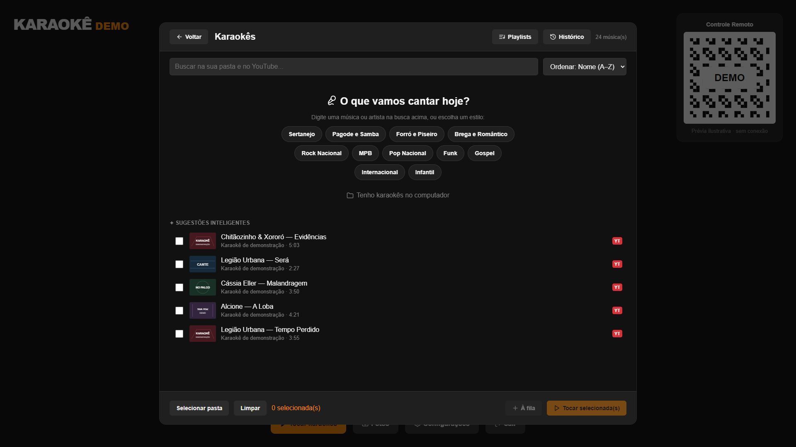

# Capturas da Fase 1

Geradas por Playwright em 02/10/2026. Originais de teste em `apps/desktop/test-results/screenshots/`; esta pasta preserva as evidências após novas execuções.

## Principais — 1920×1080

| Tela | Captura |
| --- | --- |
| Home | [home-1920x1080.png](home-1920x1080.png) |
| Karaokês | [karaokes-1920x1080.png](karaokes-1920x1080.png) |
| Player pausado | [player-1920x1080.png](player-1920x1080.png) |
| Configurações | [settings-1920x1080.png](settings-1920x1080.png) |
| Personalização | [personalizacao-1920x1080.png](personalizacao-1920x1080.png) |
| Estatísticas | [statistics-1920x1080.png](statistics-1920x1080.png) |
| Intervalo | [intervalo-1920x1080.png](intervalo-1920x1080.png) |
| Pontuação | [pontuacao-1920x1080.png](pontuacao-1920x1080.png) |

## Resoluções adicionais

| Resolução | Karaokês | Configurações | Playlists |
| --- | --- | --- | --- |
| 1366×768 | [Abrir](karaokes-1366x768.png) | [Abrir](settings-1366x768.png) | [Abrir](playlists-1366x768.png) |
| 1600×900 | [Abrir](karaokes-1600x900.png) | [Abrir](settings-1600x900.png) | [Abrir](playlists-1600x900.png) |
| 2560×1440 | [Abrir](karaokes-2560x1440.png) | [Abrir](settings-2560x1440.png) | [Abrir](playlists-2560x1440.png) |

[Captura do build executado no Electron](electron-desktop.png).

