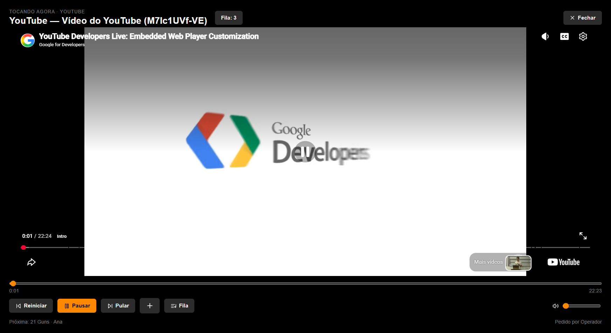

# YouTube no Electron

Captura de reprodução real de vídeo público do canal Google for Developers, realizada em 04/10/2026, com volume zero. Não é um mock da IFrame API.

Para usar: `pnpm dev` → Karaokês → YouTube → colar link → Selecionar pelo link → Tocar selecionada(s).

Busca por nome: configurar sua chave de YouTube Data API v3 em Configurações → YouTube. A chave permanece apenas na sessão. [Detalhes](../../architecture/youtube.md).
